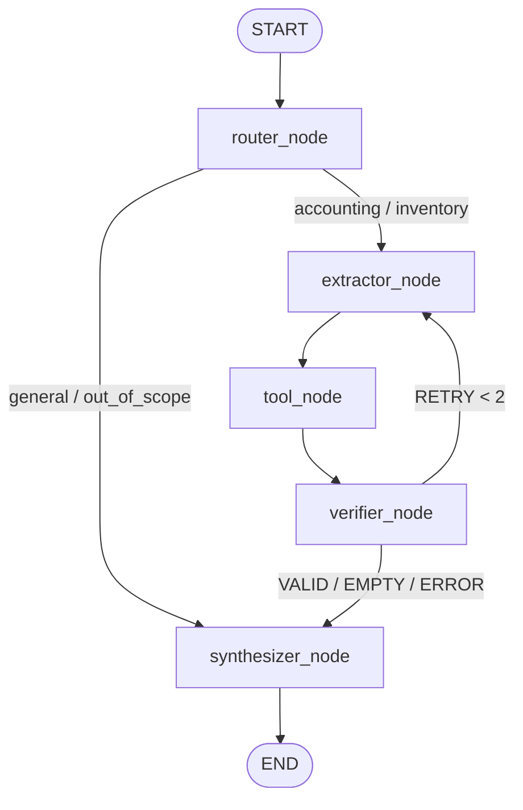

# FastPrint ERP AI Orchestrator — Agent Operating Guidelines (`GEMINI.md`)

This document serves as the canonical operational specification and codebase guide for AI coding assistants (Antigravity `agy`, Cursor, Claude Code, Copilot) and software engineers working on the `erp-langgraph` repository.

---

## 1. Project Overview & Tech Stack

`erp-langgraph` is an autonomous AI Orchestrator service designed to interface with the FastPrint ERP Django backend (`ai_tools` layer). It executes intelligent business queries, accounting ledger analysis, and inventory monitoring via a compiled LangGraph `StateGraph` pipeline.

### Core Architecture & Components
- **Runtime & Language**: Python 3.11+
- **API Service**: FastAPI (served via `uvicorn` on port `8001`)
- **Agent Framework**: LangGraph (`langgraph.graph.StateGraph`), LangChain Core (`langchain_core`)
- **Settings & Validation**: Pydantic v2 (`pydantic-settings`, `BaseModel`)
- **HTTP Clients**:
  - `app/services/django_client.py`: `DjangoCoreClient` — Asynchronous HTTP client (`httpx.AsyncClient`) communicating with ERP Django (`/ai/tools/`).
  - `app/services/erp_client.py`: `ERPClient` — Synchronous HTTP client (`httpx.Client`).
- **LLM Engine**:
  - `app/services/llm.py`: Multi-provider factory supporting OpenRouter and OpenAI.
  - Implements dynamic free-tier model discovery and automatic fallback failover when primary models are unavailable or rate-limited.

---

## 2. Developer Workflows & Essential Commands

Always activate the project virtual environment before executing commands:

### Environment Setup
```powershell
# PowerShell (Windows)
.\.venv\Scripts\Activate.ps1
```

### Running Tests
The test suite utilizes the standard Python `unittest` framework. **Do not execute `pytest` unless installed.**
```powershell
# Run the complete test suite (145 tests)
.\.venv\Scripts\python.exe -m unittest discover tests

# Run a specific test module
.\.venv\Scripts\python.exe -m unittest tests/test_workflow.py

# Run an individual test case
.\.venv\Scripts\python.exe -m unittest tests.test_router_extractor_nodes.TestRouterNode.test_greeting_routes_to_general
```

### Running Applications
```powershell
# Interactive Terminal CLI Runner
python cli.py

# FastAPI Orchestrator Service (Port 8001)
uvicorn app.main:app --host 0.0.0.0 --port 8001 --reload
```

---

## 3. LangGraph StateGraph Architecture

The system executes a deterministic 5-node StateGraph pipeline with conditional routing and adaptive retry loops:



### State Model (`AgentState` in `app/graph/state.py`)
`AgentState` is a `TypedDict` containing:
- `messages`: List of chat messages (`SystemMessage`, `HumanMessage`, `AIMessage`).
- `company_id`: Scoped ERP company ID (integer, default `1`).
- `detected_domain`: Domain classified by router (`accounting`, `inventory`, `general`, `out_of_scope`).
- `detected_tool`: Specific ERP tool name or `None`.
- `extracted_filters`: Validated Pydantic parameter dict for the tool.
- `tool_raw_result`: Raw payload envelope returned from Django Core (`ToolEnvelopeResponse`).
- `calculations`: Server-side calculated summary metrics preserved for the synthesizer.
- `verification_status`: Status enum (`PENDING`, `VALID`, `EMPTY`, `RETRY`, `ERROR`).
- `retry_count`: Integer counter tracking verification retry attempts (max `2`).
- `retry_instruction`: Feedback string directing `extractor_node` to broaden filters.

### Pipeline Nodes (`app/graph/nodes/`)
1. **`router_node` (`router.py`)**:
   - Classifies query intent into domains (`accounting`, `inventory`, `general`, `out_of_scope`).
   - Applies negative guardrails: greetings and non-ERP questions route directly to `synthesizer`.
2. **`extractor_node` (`extractor.py`)**:
   - Extracts entity IDs, names, and temporal date filters into ISO 8601 (`YYYY-MM-DD`).
   - Validates parameters against tool schemas in `app/schemas/tools.py`.
   - Incorporates `retry_instruction` during retry cycles to broaden date ranges or relax constraints.
3. **`tool_node` (`tool_node.py`)**:
   - Dispatches async requests via `DjangoCoreClient` to `POST /ai/tools/<domain>/<tool_name>/`.
   - Captures calculation envelopes without loss and catches `DjangoCoreClientError` cleanly.
4. **`verifier_node` (`verifier.py`)**:
   - Evaluates record count and data validity.
   - If 0 records are found and `retry_count < 2`, increments `retry_count` and cycles back to `extractor_node`.
   - Once `retry_count >= 2`, proceeds to `synthesizer` with status `EMPTY`.
5. **`synthesizer_node` (`synthesizer.py`)**:
   - Synthesizes user-facing Markdown with structured tables, IDR currency formatting (`Rp`), and reference codes.
   - Provides polite error recovery explanations when access is denied or records are missing.

---

## 4. ERP Domain Rules & Safety Guardrails

### 4.1 Strict Multi-Company Scoping
- FastPrint ERP is strictly multi-company. Every single ERP query and tool call **MUST** include a valid `company_id`.
- Default company fallback is `1` (`settings.DEFAULT_COMPANY_ID`). Never dispatch tool requests with an empty or `None` company ID.

### 4.2 Read vs. Write Safety (Human-in-the-Loop)
- **Read Operations (`is_write: false`)**: Execute autonomously (e.g., `get_account_balance`, `get_stock_level`, `get_journal_entries`, `get_product_info`).
- **Write Operations (`is_write: true`)**: Modifications (creating journal vouchers, moving stock, adjusting balances) **STRICTLY REQUIRE** human confirmation.
- The agent must summarize proposed parameters to the user and receive affirmative confirmation before sending `"confirm": true` to the backend.

### 4.3 Accounting & Inventory Knowledge
- **Dates**: All dates must strictly format as `YYYY-MM-DD` (ISO 8601).
- **Chart of Accounts (COA)**:
  - `1xxx`: Assets | `2xxx`: Liabilities | `3xxx`: Equity
  - `4xxx`: Revenue | `5xxx`: Cost of Goods Sold (COGS) | `6xxx`: Expenses
- **Inventory Stock Quants**:
  - `quantity`: Physical warehouse inventory count.
  - `available_quantity`: Physical count minus reserved order stock.
  - Always prefer exact SKU (`default_code`) or Barcode lookup before broad keyword matching.

### 4.4 Data Grounding & Anti-Hallucination
- Only state financial figures and stock numbers present in `tool_raw_result` or `calculations`.
- If an entity or transaction does not exist, explicitly inform the user rather than estimating or hallucinating.
- Always cite reference numbers (`JE/2026/...`, SKU, Account Code) for cross-system verification.

---

## 5. Agent Coding Guidelines & Contribution Rules

When modifying or adding features to this repository:

1. **State Immutability in StateGraph**:
   - Node functions must return a dictionary delta (e.g. `{"verification_status": VerificationStatus.VALID, "retry_count": count + 1}`).
   - Never mutate the input `state` dictionary in-place.
2. **Type Annotations & Validation**:
   - Use explicit Python type hints (`typing.Optional`, `typing.Dict`, `typing.List`, `typing.Any`).
   - Validate external inputs through Pydantic models in `app/schemas/tools.py`.
3. **Async / Sync Client Separation**:
   - StateGraph pipeline nodes are asynchronous and use `DjangoCoreClient` (`app/services/django_client.py`).
   - Use `ERPClient` (`app/services/erp_client.py`) only when synchronous execution is explicitly required.
4. **Preserve Documentation & Comments**:
   - Do not remove existing docstrings, module headers, or `TASK-X.X` reference tags.
5. **Code Intelligence with CodeGraph**:
   - For codebase exploration, architectural queries, diagnosing bugs, or surveying symbols before an edit, prioritize using **CodeGraph** (`codegraph_explore` MCP tool or `codegraph explore <query>` CLI).
   - Use CodeGraph to inspect symbol call paths, blast radius, and affected test files in a single pass instead of broad grep/read loops.
   - Treat code blocks returned by `codegraph_explore` as already read; avoid redundant file reads.
   - Run `codegraph sync` after adding or renaming major symbols to keep the local graph index synchronized.
6. **Continuous Verification**:
   - Before finishing any turn or declaring a task complete, run the full test suite:
     `.\.venv\Scripts\python.exe -m unittest discover tests`
   - All tests must pass with zero failures.

---

## 6. Communication & Anti-AI-Slop Standards

All generated text, commit messages, PR descriptions, and agent responses must be direct, sharp, and human. Eliminate generic AI filler and corporate buzzwords:

### 6.1 Direct, Concrete Prose
- **Lead with the Answer**: Answer questions or state findings immediately. Cut throat-clearing openers (*"Certainly!"*, *"I'd be happy to help"*, *"Here's the thing"*, *"Let me be clear"*).
- **Show, Don't Tell**: Let facts, code line numbers, and concrete metrics carry the weight. Never label a point *"crucial"*, *"pivotal"*, or *"vital"*—demonstrate its importance with evidence.
- **No Dramatic Reveals & Binary Contrasts**: Avoid binary setups (*"It's not X, it's Y"* / *"Not just X, but Y"*) and colon reveals (*"The best part: it works"*). State points directly in complete sentences.
- **No Summary Recaps**: Never end with redundant recap paragraphs (*"In conclusion"*, *"Overall"*, *"In summary"*). Stop on the last concrete action, result, or verifiable takeaway.

### 6.2 Banned AI Buzzwords & Corporate Slop
- **Strictly Banned**: *delve, foster, leverage, utilize, facilitate, empower, streamline, robust, cutting-edge, paradigm shift, game changer, tapestry, realm, beacon, multifaceted, intricate, paramount, transformative, elevate, embark, supercharge, harness, ever-evolving*.
- **Empty Adverbs to Strip**: *fundamentally, crucially, inherently, inevitably, literally, truly*.
- **Empty Filler Phrases to Cut**: *it's worth noting, it's important to note, at the end of the day, when it comes to, at its core, going forward*.

### 6.3 Functional, Clean Formatting
- No decorative emojis in technical headings or bullet lists.
- Avoid sprinkling bold text haphazardly across sentences for fake enthusiasm.
- Format must follow technical clarity: prefer short code blocks, exact file links, and clean markdown tables over prose lists.
