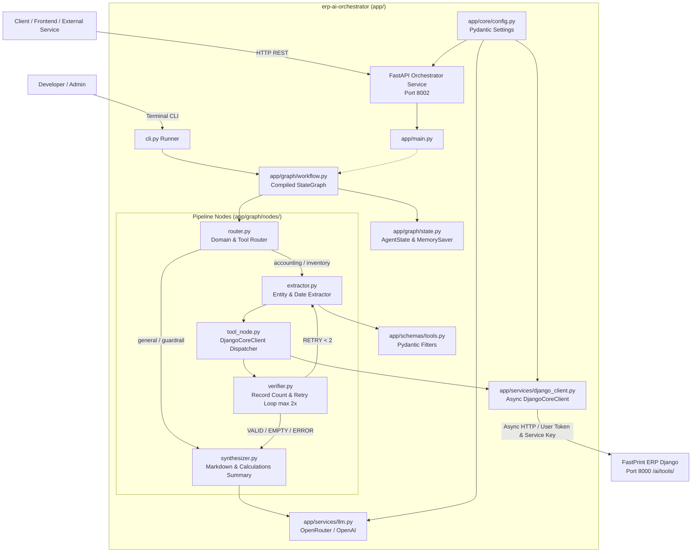

# FastPrint ERP: AI Orchestrator Service

Service orchestrator berbasis FastAPI dan LangGraph untuk integrasi agen dengan FastPrint ERP (layer `ai_tools`).

---

## Arsitektur Sistem



---

## Modul & Tool Native FastPrint ERP

Service ini berinteraksi dengan layer `/ai/tools/` pada Django Core FastPrint ERP:

| Domain | Tool Name | Deskripsi & Kemampuan |
|---|---|---|
| **Accounting** | `fetch_vendor_invoices` | Menelusuri faktur tagihan vendor/pemasok, total tagihan, dan status pembayaran. |
| **Accounting** | `get_account_balance` | Mengecek saldo Chart of Accounts (COA), buku kas, dan neraca keuangan. |
| **Accounting** | `get_journal_entries` | Mengambil catatan transaksi entri jurnal umum dengan filter tanggal dan nomor dokumen. |
| **Inventory** | `get_stock_level` | Mengambil kuantitas on-hand stok barang per perusahaan, mendukung **Sequential 2-Step Location Resolution** (*nama gudang teks -> ID lokasi*). |
| **Inventory** | `get_product_info` | Mengambil master katalog barang (SKU, barcode, harga jual, dan status varian). |
| **Inventory** | `get_locations` | Menampilkan daftar master lokasi penyimpanan dan gudang (*warehouses*) yang aktif. |

### Sequential 2-Step Location Resolution
Ketika pengguna menanyakan stok pada gudang tertentu menggunakan nama teks (contoh: *"kalau produk itu di mainstore berapa stoknya"*):
1. **Step 1**: `tool_node` secara otomatis memanggil `inventory.get_locations(search="mainstore")` untuk menyelesaikan ID lokasi secara dinamis dari database ERP.
2. **Step 2**: `tool_node` mengeksekusi `inventory.get_stock_level(code="...", location_id=...)` menggunakan ID lokasi yang ditemukan, sehingga kuantitas fisik yang ditampilkan akurat untuk gudang tersebut.

---

## Struktur Berkas

```text
erp-langgraph/
├── app/
│   ├── __init__.py
│   ├── main.py                 # Service FastAPI (GET /health, dsb.)
│   ├── core/
│   │   ├── __init__.py
│   │   └── config.py           # Konfigurasi via pydantic-settings
│   ├── schemas/
│   │   ├── __init__.py
│   │   └── tools.py            # Pydantic input filter & response envelope
│   ├── services/
│   │   ├── __init__.py
│   │   ├── erp_client.py       # Sync HTTP client (httpx.Client) ke /ai/tools/
│   │   ├── django_client.py    # Async HTTP client (httpx.AsyncClient) ke Django Core
│   │   └── llm.py              # LLM factory (OpenRouter & OpenAI)
│   ├── tools/
│   │   ├── __init__.py
│   │   ├── static.py           # Typed tools schema (Accounting & Inventory)
│   │   └── dynamic.py          # Dynamic tool loader dari GET /ai/tools/
│   └── graph/
│       ├── __init__.py
│       ├── state.py            # AgentState TypedDict, VerificationStatus, create_initial_state
│       ├── workflow.py         # Full StateGraph workflow compilation & dual async/sync runners (TASK-4.6)
│       ├── agent.py            # LangGraph ReAct agent starter
│       └── nodes/
│           ├── __init__.py
│           ├── router.py       # Hybrid domain & tool router node (negative guardrails & Indonesian suffixes)
│           ├── extractor.py    # Schema registry, multi-turn history coreference, & temporal date extractor
│           ├── tool_node.py    # Tool execution node (calculations preservation, error capture, & sequential 2-step lookup)
│           ├── verifier.py     # Data verification node (adaptive records count, retry loop max 2x)
│           └── synthesizer.py  # Markdown synthesis node (calculations formatting & polite error recovery)
├── tests/
│   ├── test_config_llm.py      # Unit test konfigurasi & LLM client
│   ├── test_llm_fallbacks.py   # Unit test dynamic free models catalog & OpenRouter auto-fallback
│   ├── test_schemas_tools.py   # Unit test schema tools & response envelope
│   ├── test_django_client.py   # Unit test Async HTTP Django client
│   ├── test_graph_state.py     # Unit test LangGraph AgentState & workflow cycle
│   ├── test_router_extractor_nodes.py # Unit test Router & Extractor nodes (TASK-4.2)
│   ├── test_tool_node.py       # Unit test Tool Node execution (TASK-4.3)
│   ├── test_verifier_node.py   # Unit test Verifier Node & retry cycle (TASK-4.4)
│   ├── test_synthesizer_node.py# Unit test Synthesizer Node formatting (TASK-4.5)
│   ├── test_workflow.py        # Unit test StateGraph pipeline compilation & E2E execution (TASK-4.6)
│   └── test_cli.py             # Unit test interactive StateGraph CLI runner
├── cli.py                      # Interactive CLI runner
├── prompts/
│   └── erp_system_prompt.md    # System prompt konteks ERP
├── docs/
│   ├── AI_TOOLS_HANDOFF.md     # Spesifikasi handoff
│   └── LANGGRAPH_INTEGRATION.md# Panduan teknis integrasi
├── requirements.txt            # Dependensi Python
├── .env.example                # Template konfigurasi environment
└── README.md                   # Dokumentasi proyek
```

---

## Konfigurasi Environment

Konfigurasi dibaca dari variabel environment atau file `.env`:

| Variabel | Tipe | Default | Keterangan |
|---|---|---|---|
| `APP_NAME` | string | `"erp-ai-orchestrator"` | Nama aplikasi service |
| `APP_ENV` | string | `"development"` | Mode environment (`development`/`production`) |
| `APP_HOST` | string | `"0.0.0.0"` | Host binding FastAPI |
| `APP_PORT` | integer | `8002` | Port service FastAPI |
| `LOG_LEVEL` | string | `"info"` | Log level |
| `ERP_BASE_URL` | string | `"http://127.0.0.1:8000"` | URL ERP Django (alias: `DJANGO_INTERNAL_API_URL`) |
| `DEFAULT_COMPANY_ID` | integer | `1` | ID company default |
| `ERP_API_TOKEN` | string | `""` | Static JWT token / service key (alias: `DJANGO_INTERNAL_SERVICE_KEY`) |
| `ERP_USERNAME` | string | `"admin"` | Username login ERP |
| `ERP_PASSWORD` | string | `""` | Password login ERP |
| `REQUEST_TIMEOUT_SEC` | integer | `15` | Timeout request dalam detik (alias: `REQUEST_TIMEOUT`) |
| `MODEL_PROVIDER` | string | `"openrouter"` | Provider LLM (`openrouter` atau `openai`) |
| `OPENROUTER_API_KEY` | string | `""` | API key OpenRouter |
| `OPENROUTER_MODEL` | string | `"meta-llama/llama-3.3-70b-instruct:free"` | Target model OpenRouter |
| `OPENAI_API_KEY` | string | `""` | API key OpenAI |
| `OPENAI_MODEL` | string | `"gpt-4o-mini"` | Target model OpenAI |
| `USE_DYNAMIC_TOOLS` | boolean | `false` | Set `true` untuk fetch tool metadata dari ERP saat runtime |
| `ENABLE_HITL_INTERRUPT` | boolean | `false` | Set `true` untuk jeda konfirmasi tool write |

---

## Automated Testing

Jalankan test suite menggunakan modul standard library `unittest`:

```powershell
.venv\Scripts\python.exe -m unittest discover -s tests -p "test_*.py" -v
```

Cakupan 152 unit test:
- `tests/test_config_llm.py` (8 test): Singleton `Settings`, alias `DJANGO_INTERNAL_*`, timeout, inisialisasi model OpenRouter dan OpenAI.
- `tests/test_llm_fallbacks.py` (6 test): Integrasi library `free-llm-models`, kurasi model gratis, prioritas tool/JSON capabilities, dan OpenRouter 3-item fallback array compliance.
- `tests/test_schemas_tools.py` (17 test): Schema input (`AccountBalanceFilterSchema`, `JournalEntriesFilterSchema`, `StockLevelFilterSchema`, `ProductInfoFilterSchema`, `LocationsFilterSchema`), format tanggal `YYYY-MM-DD`, batas pagination, generic response envelope, dan pengikatan `args_schema`.
- `tests/test_django_client.py` (20 test): Penerusan `user_token` ke header `Authorization`, header `X-Internal-Service-Key`, mapping error HTTP 401/403/404/500, helper tools ERP (`fetch_locations`), dan context manager `async with`.
- `tests/test_graph_state.py` (5 test): Helper `create_initial_state`, partial update `total=False`, eksekusi multi-node `StateGraph(AgentState)` dengan reducer `add_messages`, dan routing kondisional.
- `tests/test_router_extractor_nodes.py` (30 test): `VendorInvoiceFilterSchema`, hybrid routing domain & tool, negative customer guardrails, infleksi sufiks Bahasa Indonesia (`stoknya`, `saldonya`), query lokasi/gudang (`get_locations`), schema registry `TOOL_SCHEMA_REGISTRY`, resolusi tanggal relatif, multi-turn conversation history coreference, dan chaining `router_node` -> `extractor_node`.
- `tests/test_tool_node.py` (15 test): Preservasi data transaksi dan blok `calculations` (DoD), forwarding `user_token`, prioritas scoping `company_id`, penanganan error HTTP 401/403/500/timeout, dynamic tool dispatching (`get_locations`), Sequential 2-Step Location Resolution, wrapper sync, dan integrasi StateGraph 3 node.
- `tests/test_verifier_node.py` (21 test): Inspeksi adaptif `records_count` lintas respons ERP, transisi status `VALID`/`RETRY`/`EMPTY`, preservasi status `ERROR`, pembatas loop maksimal 2x (DoD), relaksasi filter bertahap (tanggal lalu nama vendor), dan conditional edge `decide_after_verification`.
- `tests/test_synthesizer_node.py` (11 test): Pemformatan Markdown tabel transaksi tagihan vendor, blok `calculations`, saldo akun, stok inventaris dengan lokasi, tabel katalog produk, tabel daftar lokasi/gudang, respons ramah status `EMPTY`/`ERROR`, penegakan guardrail pelanggan, serta appending `AIMessage`.
- `tests/test_workflow.py` (14 test): Validasi conditional routing `decide_after_router`, eksekusi end-to-end `create_workflow_graph()`, pemulihan data pada siklus retry, batas pengulangan 2x, propagasi error HTTP, checkpointer memori multi-turn `thread_id`, end-to-end 2-step location resolution flow, dan runner sinkron `run_workflow_sync`.
- `tests/test_cli.py` (5 test): Interaktivitas CLI StateGraph 5-node runner, perintah khusus (`exit`, `new`, `verbose`, `co <id>`, `token <jwt>`), dan penanganan interrupt `Ctrl+C`.

---

## Quick Start

### 1. Siapkan Environment dan Dependensi

Gunakan Python 3.11+:

```powershell
py -3.11 -m venv .venv
.venv\Scripts\Activate.ps1
pip install -r requirements.txt
```

### 2. Atur File `.env`

```powershell
cp .env.example .env
```
Isi kredensial ERP dan API key LLM yang digunakan.

### 3. Jalankan Service FastAPI

```powershell
uvicorn app.main:app --port 8002 --reload
```

Cek endpoint health:
```powershell
Invoke-RestMethod -Uri "http://127.0.0.1:8002/health" -Method Get
```

Dokumentasi API:
- Swagger UI: [http://localhost:8002/docs](http://localhost:8002/docs)
- ReDoc: [http://localhost:8002/redoc](http://localhost:8002/redoc)

### 4. Jalankan Terminal CLI

```powershell
python cli.py
```
