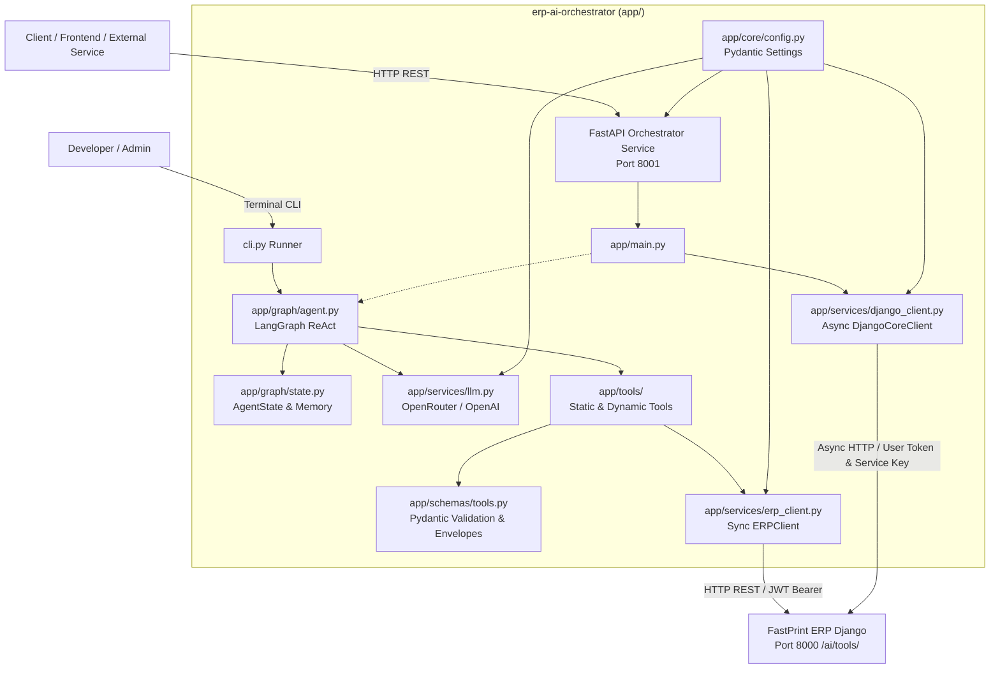

# FastPrint ERP — AI Orchestrator Service

Dedicated AI Orchestrator service berbasis **FastAPI** dan **LangGraph** untuk integrasi agen AI otonom dengan FastPrint ERP (`ai_tools` layer).

---

## 🏛️ Arsitektur Sistem



---

## 📁 Struktur Berkas

```text
erp-langgraph/
├── app/
│   ├── __init__.py
│   ├── main.py                 # Entry point service FastAPI (GET /health, etc.)
│   ├── core/
│   │   ├── __init__.py
│   │   └── config.py           # Konfigurasi terpusat berbasis pydantic-settings
│   ├── schemas/
│   │   ├── __init__.py
│   │   └── tools.py            # Pydantic Input Filter Schemas & Output Envelopes
│   ├── services/
│   │   ├── __init__.py
│   │   ├── erp_client.py       # Sync HTTP Client (httpx.Client) ke ERP /ai/tools/
│   │   ├── django_client.py    # Async HTTP Client (httpx.AsyncClient) ke Django Core
│   │   └── llm.py              # LLM factory mendukung OpenRouter & OpenAI
│   ├── tools/
│   │   ├── __init__.py
│   │   ├── static.py           # 4 pilot typed tools (Accounting & Inventory)
│   │   └── dynamic.py          # Dynamic tool loader dari GET /ai/tools/
│   └── graph/
│       ├── __init__.py
│       ├── state.py            # TypedDict AgentState, VerificationStatus, create_initial_state
│       └── agent.py            # LangGraph ReAct StateGraph agent
├── tests/
│   ├── test_config_llm.py      # Unit tests konfigurasi terpusat & client LLM
│   ├── test_schemas_tools.py   # Unit tests schema Pydantic tools & response envelopes
│   ├── test_django_client.py   # Unit tests Async HTTP Django Core client & error handling
│   └── test_graph_state.py     # Unit tests LangGraph AgentState & workflow cycle
├── cli.py                      # Interactive terminal runner untuk pengujian langsung
├── prompts/
│   └── erp_system_prompt.md    # System prompt context domain ERP
├── docs/
│   ├── AI_TOOLS_HANDOFF.md     # Spesifikasi handoff resmi
│   └── LANGGRAPH_INTEGRATION.md# Dokumentasi teknis integrasi
├── requirements.txt            # Dependensi Python terpadu
├── .env.example                # Template konfigurasi environment
└── README.md                   # Dokumentasi proyek
```

---

## ⚙️ Konfigurasi Environment (`.env`)

| Variabel | Tipe | Default | Keterangan |
|---|---|---|---|
| `APP_NAME` | string | `"erp-ai-orchestrator"` | Nama aplikasi service |
| `APP_ENV` | string | `"development"` | Mode environment (`development`/`production`) |
| `APP_HOST` | string | `"0.0.0.0"` | Host binding FastAPI |
| `APP_PORT` | integer | `8001` | Port service FastAPI (Port 8001 agar tidak bentrok dengan ERP Django di port 8000) |
| `LOG_LEVEL` | string | `"info"` | Logging verbosity |
| `ERP_BASE_URL` | string | `"http://127.0.0.1:8000"` | Base URL FastPrint ERP backend (alias: `DJANGO_INTERNAL_API_URL`) |
| `DEFAULT_COMPANY_ID` | integer | `1` | ID perusahaan default untuk multi-company scoping |
| `ERP_API_TOKEN` | string | `""` | Static JWT / Service Key (alias: `DJANGO_INTERNAL_SERVICE_KEY`) |
| `ERP_USERNAME` | string | `"admin"` | Username login ERP |
| `ERP_PASSWORD` | string | `""` | Password login ERP |
| `REQUEST_TIMEOUT_SEC` | integer | `15` | Timeout (detik) untuk HTTP client ERP dan request LLM (alias: `REQUEST_TIMEOUT`) |
| `MODEL_PROVIDER` | string | `"openrouter"` | Provider LLM aktif (`openrouter` atau `openai`) |
| `OPENROUTER_API_KEY` | string | `""` | API key OpenRouter |
| `OPENROUTER_MODEL` | string | `"meta-llama/llama-3.3-70b-instruct:free"` | Model target di OpenRouter |
| `OPENAI_API_KEY` | string | `""` | API key OpenAI |
| `OPENAI_MODEL` | string | `"gpt-4o-mini"` | Model target OpenAI |
| `USE_DYNAMIC_TOOLS` | boolean | `false` | `true` untuk fetch tools dari ERP saat runtime |
| `ENABLE_HITL_INTERRUPT` | boolean | `false` | `true` untuk jeda eksekusi tool write (Human-in-the-Loop) |

---

## 🧪 Automated Testing Suite

Repositori dilengkapi dengan unit test otomatis berbasis Python standard library `unittest` (tanpa memerlukan dependensi luar):

```powershell
# Jalankan seluruh unit test suite
.venv\Scripts\python.exe -m unittest discover -s tests -p "test_*.py" -v
```

### Cakupan Pengujian:
1. **`tests/test_config_llm.py` (8 tests)**:
   - Validasi singleton `Settings`, alias environment `DJANGO_INTERNAL_*`, dan fallback timeout.
   - Validasi inisialisasi factory LLM `ChatOpenAI` untuk OpenRouter dan OpenAI.
2. **`tests/test_schemas_tools.py` (17 tests)**:
   - Validasi input filter schemas (`AccountBalanceFilterSchema`, `JournalEntriesFilterSchema`, `StockLevelFilterSchema`, `ProductInfoFilterSchema`).
   - Penolakan format tanggal salah (wajib regex `YYYY-MM-DD`) dan batasan rentang pagination (`limit`).
   - Validasi kontrak response envelope standar Django `ERPResponseEnvelope[T]` dan `ERPErrorDetail`.
   - Verifikasi pengikatan `args_schema` pada `app/tools/static.py`.
3. **`tests/test_django_client.py` (18 tests)**:
   - Verifikasi penerusan token user via header `Authorization: Bearer <user_token>`.
   - Verifikasi header `X-Internal-Service-Key` dan `X-AI-Source: LangGraph`.
   - Pemetaan terstruktur status HTTP 401 (`DjangoAuthError`), 403 (`DjangoPermissionError`), 404 (`DjangoNotFoundError`), dan 500 (`DjangoServerError`).
   - Eksekusi helper 4 tools riil ERP dan alias `fetch_vendor_invoices`.
   - Verifikasi lifecycle async context manager (`async with`).
4. **`tests/test_graph_state.py` (5 tests)**:
   - Verifikasi inisialisasi state awal via `create_initial_state`.
   - Verifikasi dukungan partial updates `total=False`.
   - Verifikasi eksekusi siklus penuh `StateGraph(AgentState)` multi-node dengan reducer `add_messages`.
   - Verifikasi routing kondisional berbasis `verification_status`.

---

## 🚀 Quick Start

### 1. Inisialisasi Environment & Install Dependensi

Gunakan Python 3.11+:

```powershell
# Buat virtual environment
py -3.11 -m venv .venv

# Aktifkan virtual environment (PowerShell)
.venv\Scripts\Activate.ps1

# Install dependensi
pip install -r requirements.txt
```

### 2. Konfigurasi File `.env`

```powershell
cp .env.example .env
```
Sesuaikan `ERP_USERNAME`, `ERP_PASSWORD`, serta `OPENROUTER_API_KEY` / `OPENAI_API_KEY`.

### 3. Menjalankan Service FastAPI

Jalankan server menggunakan Uvicorn:

```powershell
uvicorn app.main:app --port 8001 --reload
```

#### Verifikasi Endpoint Health:
```powershell
Invoke-RestMethod -Uri "http://127.0.0.1:8001/health" -Method Get
```
Output:
```json
{"status": "healthy"}
```

#### Dokumentasi API Otomatis (Swagger UI):
Buka di browser:
- Swagger UI: [http://localhost:8001/docs](http://localhost:8001/docs)
- ReDoc: [http://localhost:8001/redoc](http://localhost:8001/redoc)

### 4. Menjalankan Terminal CLI Interaktif (Opsional)

Untuk pengujian agent secara langsung via terminal console:

```powershell
python cli.py
```
