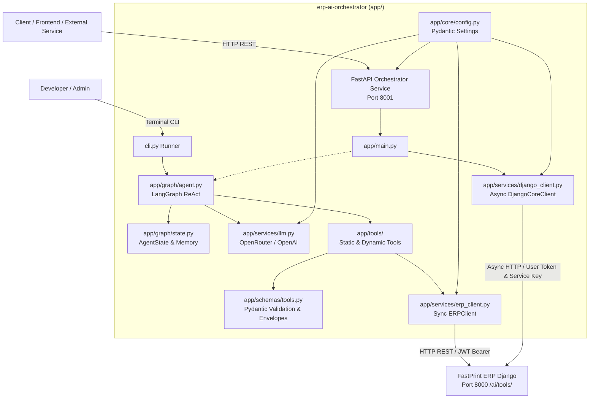

# FastPrint ERP: AI Orchestrator Service

Service orchestrator berbasis FastAPI dan LangGraph untuk integrasi agen dengan FastPrint ERP (layer `ai_tools`).

---

## Arsitektur Sistem



---

## Struktur Berkas

```text
erp-langgraph/
├── app/
│   ├── __init__.py
│   ├── main.py                 # Service FastAPI (GET /health, dsb.)
│   ├── core/
│   │   ├── __init__.py
│   │   └── config.py           # Konfigurasi via pydantic-settings
│   ├── schemas/
│   │   ├── __init__.py
│   │   └── tools.py            # Pydantic input filter & response envelope
│   ├── services/
│   │   ├── __init__.py
│   │   ├── erp_client.py       # Sync HTTP client (httpx.Client) ke /ai/tools/
│   │   ├── django_client.py    # Async HTTP client (httpx.AsyncClient) ke Django Core
│   │   └── llm.py              # LLM factory (OpenRouter & OpenAI)
│   ├── tools/
│   │   ├── __init__.py
│   │   ├── static.py           # 4 tool typed (Accounting & Inventory)
│   │   └── dynamic.py          # Dynamic tool loader dari GET /ai/tools/
│   └── graph/
│       ├── __init__.py
│       ├── state.py            # AgentState TypedDict, VerificationStatus, create_initial_state
│       └── agent.py            # LangGraph ReAct agent
├── tests/
│   ├── test_config_llm.py      # Unit test konfigurasi & LLM client
│   ├── test_schemas_tools.py   # Unit test schema tools & response envelope
│   ├── test_django_client.py   # Unit test Async HTTP Django client
│   └── test_graph_state.py     # Unit test LangGraph AgentState & workflow cycle
├── cli.py                      # Interactive CLI runner
├── prompts/
│   └── erp_system_prompt.md    # System prompt konteks ERP
├── docs/
│   ├── AI_TOOLS_HANDOFF.md     # Spesifikasi handoff
│   └── LANGGRAPH_INTEGRATION.md# Panduan teknis integrasi
├── requirements.txt            # Dependensi Python
├── .env.example                # Template konfigurasi environment
└── README.md                   # Dokumentasi proyek
```

---

## Konfigurasi Environment

Konfigurasi dibaca dari variabel environment atau file `.env`:

| Variabel | Tipe | Default | Keterangan |
|---|---|---|---|
| `APP_NAME` | string | `"erp-ai-orchestrator"` | Nama aplikasi service |
| `APP_ENV` | string | `"development"` | Mode environment (`development`/`production`) |
| `APP_HOST` | string | `"0.0.0.0"` | Host binding FastAPI |
| `APP_PORT` | integer | `8001` | Port service FastAPI |
| `LOG_LEVEL` | string | `"info"` | Log level |
| `ERP_BASE_URL` | string | `"http://127.0.0.1:8000"` | URL ERP Django (alias: `DJANGO_INTERNAL_API_URL`) |
| `DEFAULT_COMPANY_ID` | integer | `1` | ID company default |
| `ERP_API_TOKEN` | string | `""` | Static JWT token / service key (alias: `DJANGO_INTERNAL_SERVICE_KEY`) |
| `ERP_USERNAME` | string | `"admin"` | Username login ERP |
| `ERP_PASSWORD` | string | `""` | Password login ERP |
| `REQUEST_TIMEOUT_SEC` | integer | `15` | Timeout request dalam detik (alias: `REQUEST_TIMEOUT`) |
| `MODEL_PROVIDER` | string | `"openrouter"` | Provider LLM (`openrouter` atau `openai`) |
| `OPENROUTER_API_KEY` | string | `""` | API key OpenRouter |
| `OPENROUTER_MODEL` | string | `"meta-llama/llama-3.3-70b-instruct:free"` | Target model OpenRouter |
| `OPENAI_API_KEY` | string | `""` | API key OpenAI |
| `OPENAI_MODEL` | string | `"gpt-4o-mini"` | Target model OpenAI |
| `USE_DYNAMIC_TOOLS` | boolean | `false` | Set `true` untuk fetch tool metadata dari ERP saat runtime |
| `ENABLE_HITL_INTERRUPT` | boolean | `false` | Set `true` untuk jeda konfirmasi tool write |

---

## Automated Testing

Jalankan test suite menggunakan modul standard library `unittest`:

```powershell
.venv\Scripts\python.exe -m unittest discover -s tests -p "test_*.py" -v
```

Cakupan 48 unit test:
- `tests/test_config_llm.py` (8 test): Singleton `Settings`, alias `DJANGO_INTERNAL_*`, timeout, inisialisasi model OpenRouter dan OpenAI.
- `tests/test_schemas_tools.py` (17 test): Schema input (`AccountBalanceFilterSchema`, `JournalEntriesFilterSchema`, `StockLevelFilterSchema`, `ProductInfoFilterSchema`), format tanggal `YYYY-MM-DD`, batas pagination, generic response envelope, dan pengikatan `args_schema`.
- `tests/test_django_client.py` (18 test): Penerusan `user_token` ke header `Authorization`, header `X-Internal-Service-Key`, mapping error HTTP 401/403/404/500, helper 4 tool ERP, dan context manager `async with`.
- `tests/test_graph_state.py` (5 test): Helper `create_initial_state`, partial update `total=False`, eksekusi multi-node `StateGraph(AgentState)` dengan reducer `add_messages`, dan routing kondisional.

---

## Quick Start

### 1. Siapkan Environment dan Dependensi

Gunakan Python 3.11+:

```powershell
py -3.11 -m venv .venv
.venv\Scripts\Activate.ps1
pip install -r requirements.txt
```

### 2. Atur File `.env`

```powershell
cp .env.example .env
```
Isi kredensial ERP dan API key LLM yang digunakan.

### 3. Jalankan Service FastAPI

```powershell
uvicorn app.main:app --port 8001 --reload
```

Cek endpoint health:
```powershell
Invoke-RestMethod -Uri "http://127.0.0.1:8001/health" -Method Get
```

Dokumentasi API:
- Swagger UI: [http://localhost:8001/docs](http://localhost:8001/docs)
- ReDoc: [http://localhost:8001/redoc](http://localhost:8001/redoc)

### 4. Jalankan Terminal CLI

```powershell
python cli.py
```
