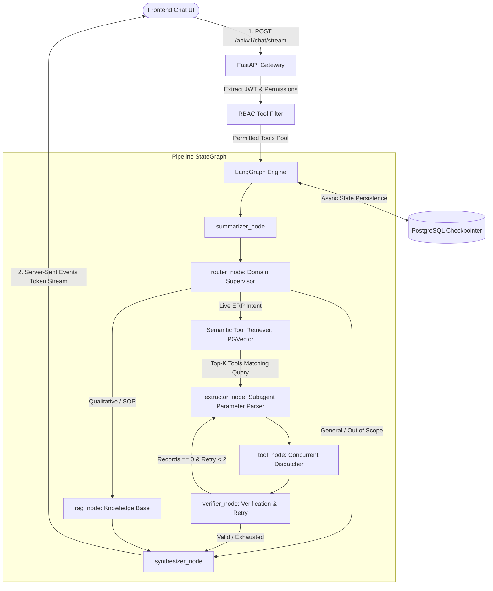

# Rencana Arsitektur & Implementasi: FastPrint ERP AI Orchestrator Menuju Standar Enterprise Production

## 1. Goal Description

Mempersiapkan dan mengoptimasi layanan FastPrint ERP AI Orchestrator (`erp-langgraph`) dari kondisi saat ini (2 domain: Accounting & Inventory, 18 tools statis) menjadi arsitektur tingkat produksi enterprise (*production-ready*) yang mampu menangani skala besar (50–200+ tools di berbagai modul ERP seperti Sales, Purchase, Manufacturing, HR, Inventory, Accounting) dengan latensi rendah, streaming real-time, persistensi multi-pod, dan isolasi keamanan berbasis peran (RBAC).

---

## 2. User Review Required

> [!IMPORTANT]
> **Transisi dari In-Memory ke Persistent Checkpointer**:
> Penggunaan `MemorySaver` saat ini hanya cocok untuk pengujian lokal (`cli.py` dan unit tests). Untuk lingkungan produksi multi-instans (Docker Swarm / Kubernetes), sesi percakapan harus disimpan di PostgreSQL (`PostgresSaver` / `AsyncPostgresSaver`). Dibutuhkan kepastian ketersediaan tabel checkpointer pada database PostgreSQL target.

> [!WARNING]
> **Deprecasi Enum Tool Statis**:
> Saat jumlah tool melampaui 25+, pendekatan enum `Literal[...]` pada Pydantic model (`PlannedToolCall` di `router.py`) dan regex pattern matching akan digantikan secara bertahap oleh *Dynamic Semantic Tool Retrieval* (RAG untuk Tool). Ini memengaruhi cara registrasi tool baru dari backend Django ERP.

---

## 3. Open Questions

> [!NOTE]
> 1. **Prioritas Fase**: Apakah kita ingin memprioritaskan **Fase 3.1 (Streaming SSE + Postgres Checkpointer)** terlebih dahulu agar frontend chat responsif, atau **Fase 3.2 (Semantic Tool Indexing)** untuk persiapan modul-modul baru ERP?
> 2. **Mekanisme Otentikasi User**: Apakah backend Django sudah mengirimkan klaim hak akses pengguna (misal: user groups / permission codenames) di dalam payload JWT saat memanggil API `/api/v1/chat`?

---

## 4. Arsitektur Target (Enterprise Scale)



---

## 5. Proposed Changes

### Komponen 1: Real-Time Streaming & API Gateway (`app/main.py`)
Mendukung interaksi chat responsif berbasis Server-Sent Events (SSE) sehingga token sintesis dan event eksekusi tool dapat langsung diterima frontend tanpa blocking.

#### [MODIFY] `app/main.py`
* Tambahkan endpoint streaming `POST /api/v1/chat/stream`.
* Gunakan `StreamingResponse` dengan media type `text/event-stream`.
* Manfaatkan event stream LangGraph `workflow.astream_events(..., version="v2")`.

```python
# Cuplikan implementasi streaming di app/main.py
from fastapi.responses import StreamingResponse
import json

@app.post("/api/v1/chat/stream", summary="Chat stream via SSE")
async def chat_stream_endpoint(request: ChatRequest):
    async def event_generator():
        workflow = get_compiled_workflow()
        initial_state = create_initial_state(
            query=request.message,
            company_id=request.company_id,
            conversation_id=request.conversation_id,
        )
        config = {"configurable": {"thread_id": request.conversation_id}}

        async for event in workflow.astream_events(initial_state, config=config, version="v2"):
            kind = event.get("event")
            if kind == "on_chat_model_stream":
                content = event["data"]["chunk"].content
                if content:
                    yield f"data: {json.dumps({'type': 'token', 'content': content})}\n\n"
            elif kind == "on_tool_start":
                tool_name = event.get("name")
                yield f"data: {json.dumps({'type': 'tool_start', 'tool': tool_name})}\n\n"
            elif kind == "on_tool_end":
                yield f"data: {json.dumps({'type': 'tool_end'})}\n\n"
        yield "data: [DONE]\n\n"

    return StreamingResponse(event_generator(), media_type="text/event-stream")
```

---

### Komponen 2: Persistent Checkpointer Multi-Pod (`app/graph/workflow.py`)
Memisahkan dependensi in-memory `MemorySaver` agar sesi percakapan aman saat di-restart atau di-scale secara horizontal.

#### [MODIFY] `app/graph/workflow.py`
* Buat factory `get_checkpointer()` yang secara dinamis memilih:
  - `AsyncPostgresSaver` jika `POSTGRES_CHECKPOINT_URL` terkonfigurasi.
  - `MemorySaver` jika berjalan di lingkungan testing (`APP_ENV=test` atau `unittest`).

```python
# Cuplikan konfigurasi checkpointer di app/graph/workflow.py
from langgraph.checkpoint.memory import MemorySaver

def get_default_checkpointer():
    if settings.APP_ENV == "test" or not settings.CHECKPOINT_DB_URL:
        return MemorySaver()
    # Inisialisasi pool AsyncPostgresSaver untuk production multi-replica
    from langgraph.checkpoint.postgres.aio import AsyncPostgresSaver
    return AsyncPostgresSaver.from_conn_string(settings.CHECKPOINT_DB_URL)
```

---

### Komponen 3: Dynamic Semantic Tool Retrieval (Solusi 50–200+ Tools)
Menghilangkan ketergantungan enum statis di `router.py` dan mencegah LLM context window kehabisan token.

#### [NEW] `app/services/tool_registry_service.py`
* Menyimpan katalog metadata seluruh tool (nama, domain, deskripsi, parameter JSON schema, permission code) ke dalam tabel dedicated `ai_tool_catalog` di PostgreSQL.
* Menggunakan Gemini Embedding untuk menghitung vektor embedding dari deskripsi fungsional tiap tool.
* Fungsi `search_relevant_tools(query, domain=None, user_permissions=None, top_k=5)`:
  Melakukan HNSW vector similarity search untuk hanya menyajikan 3–5 tool paling relevan ke extractor node.

```python
# Cuplikan fungsi pencarian tool semantik
class ToolRegistryService:
    async def get_tools_for_query(
        self,
        query: str,
        user_permissions: Optional[List[str]] = None,
        top_k: int = 5
    ) -> List[Dict[str, Any]]:
        # 1. Embed query menggunakan Gemini
        query_vector = await self.vector_service.get_embedding(query)
        # 2. Query PGVector dengan filter RBAC permissions
        sql = """
            SELECT tool_name, domain, description, params_schema
            FROM ai_tool_catalog
            WHERE ($1::text[] IS NULL OR required_permission = ANY($1))
            ORDER BY embedding <=> $2 LIMIT $3;
        """
        ...
```

#### [MODIFY] `app/graph/nodes/router.py` & `app/graph/nodes/extractor.py`
* Router tingkat 1 (Supervisor) hanya bertugas menentukan kategori domain (Accounting, Inventory, Sales, HR, atau General).
* Extractor memanggil `ToolRegistryService` untuk mengambil tools yang relevan dengan kueri pengguna secara dinamis, lalu memvalidasi input Pydantic.

---

### Komponen 4: Security & RBAC Guardrail
Menjamin setiap panggilan tool tervalidasi hak aksesnya sebelum dieksekusi.

#### [MODIFY] `app/schemas/chat.py`
* Tambahkan field `user_id: Optional[str]`, `user_roles: Optional[List[str]]`, dan `auth_token: Optional[str]` pada `ChatRequest`.

#### [MODIFY] `app/graph/nodes/tool_node.py`
* Teruskan JWT pengguna ke `DjangoCoreClient` untuk menjamin otorisasi di level API Django berjalan seirama dengan otorisasi agen AI.

---

## 6. Verification Plan

### Automated Tests
1. **Regression Check**:
   Pastikan seluruh 490 test yang sudah ada tetap lolos:
   ```powershell
   .\.venv\Scripts\python.exe -m unittest discover tests
   ```
2. **Streaming Endpoint Test (`tests/test_api_chat_stream.py`)**:
   * Uji respons HTTP 200 dengan header `content-type: text/event-stream`.
   * Verifikasi pengiriman event `token`, `tool_start`, `tool_end`, dan marker `[DONE]`.
3. **Semantic Tool Search Test (`tests/test_tool_registry.py`)**:
   * Verifikasi kueri "cek stok kertas" mengembalikan tool `get_stock_level` pada ranking pertama.
   * Verifikasi filter RBAC mengaburkan tool finansial jika user tidak memiliki role `accounting_viewer`.

### Manual Verification
1. Jalankan server lokal:
   ```powershell
   .\.venv\Scripts\uvicorn.exe app.main:app --host 0.0.0.0 --port 8002 --reload
   ```
2. Uji streaming via `curl` di PowerShell / Terminal:
   ```bash
   curl -N -X POST http://localhost:8002/api/v1/chat/stream \
     -H "Content-Type: application/json" \
     -d '{"message": "Berapa saldo kas dan stok kertas A4?", "company_id": 1, "conversation_id": "test-stream-1"}'
   ```
3. Periksa konsistensi teks markdown yang diketik secara bertahap pada response buffer.
